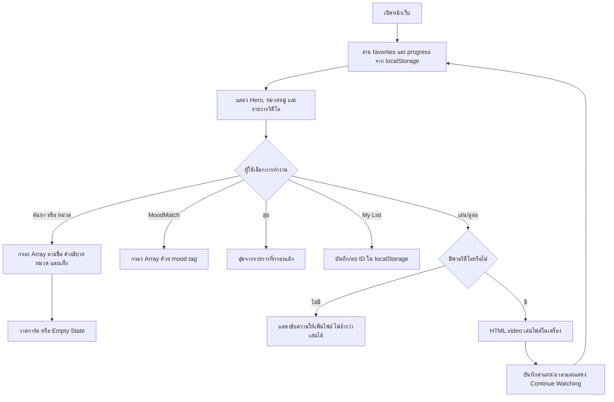

# FilmOnline — Your Private Cinema

มินิโปรเจกต์เว็บไซต์คัดสรรวิดีโอแนว Cinematic Premium ด้วย HTML, CSS และ Vanilla JavaScript เท่านั้น ไม่มีระบบสมาชิก ไม่มี Backend และไม่มี API สำหรับข้อมูลวิดีโอ

## 1. แนวคิดและจุดเด่น

FilmOnline เปลี่ยนการเลือกคลิปให้เป็นประสบการณ์โรงภาพยนตร์ส่วนตัว ใช้โทนดำและแดงไวน์ ภาพปกขนาดสม่ำเสมอ การ์ดเคลื่อนไหวเบา ๆ และหน้ารายละเอียดแบบ Modal จุดเด่นคือ **MoodMatch** กรองจากแท็กอารมณ์จริงใน Array, **Random Pick** สุ่มจากผลลัพธ์ปัจจุบัน, **Continue Watching** จดตำแหน่งด้วย localStorage และ **My List** บันทึกรายการโปรดในเครื่อง

> ข้อมูลชื่อเรื่องและคำโปรยเป็นข้อมูลตัวอย่างสำหรับการสาธิต ไม่ใช่ภาพยนตร์จริงหรือสถิติผู้ชม ภาพตัวอย่างอ้างอิงไฟล์ภาพจาก Unsplash ผ่าน URL เพื่อให้เห็นหน้าตาทันที ต้องเชื่อมต่ออินเทอร์เน็ตเพื่อโหลดภาพและฟอนต์ตัวอย่าง หากส่งงานออฟไลน์หรือใช้ภาพจริง ให้ดาวน์โหลดสื่อที่มีสิทธิ์ใช้และเก็บไว้ใน `assets/posters/` แล้วเปลี่ยน `poster`/`hero` ใน `script.js` เป็นพาธภายในโปรเจกต์

## 2. Wireframe แบบข้อความ

```text
┌────────────────────────────────────────────────────────────────┐
│ FILMONLINE   Home  Explore  Categories  My List     ค้นหา...  │ Navbar ติดด้านบน
├────────────────────────────────────────────────────────────────┤
│  ภาพ Hero เต็มแถบ + Gradient                                   │
│  FILMONLINE ORIGINALS                                           │
│  ชื่อเรื่อง / คำโปรย / หมวด / เวลา                             │
│  [Watch now] [More info]                            [ถัดไป ↗]  │
├────────────────────────────────────────────────────────────────┤
│ Trending now                                      Surprise me  │
│ BROWSE BY [All] [Action] [Comedy] ...                         │
│ [โปสเตอร์] [โปสเตอร์] [โปสเตอร์] [โปสเตอร์]                   │
│ ชื่อ/หมวด/เวลา   การ์ดกดดูรายละเอียด กด ♡ บันทึกรายการ         │
├────────────────────────────────────────────────────────────────┤
│ MoodMatch: ภาพกราฟิก + “What are you in the mood for?”         │
│ [หัวเราะ] [ผ่อนคลาย] [ตื่นเต้น] [แรงบันดาลใจ]                 │
├────────────────────────────────────────────────────────────────┤
│ Continue watching (แสดงเมื่อมีประวัติ) + progress bar           │
├────────────────────────────────────────────────────────────────┤
│ My list: รายการที่บันทึกไว้ / empty state                      │
└────────────────────────────────────────────────────────────────┘
  Modal รายละเอียด: ภาพ / ชื่อ / ข้อมูล / เล่น / My List
  Modal เครื่องเล่น: HTML video / สถานะเมื่อไม่มีไฟล์
```

## 3. Flowchart



## 4. โครงสร้างไฟล์

```text
FilmOnline/
├── index.html
├── style.css
├── script.js
├── README.md
└── assets/
    ├── posters/   # ภาพปกที่ได้รับอนุญาต
    ├── videos/    # คลิปที่ถ่ายเองหรือได้รับอนุญาต
    └── icons/     # ไอคอนเพิ่มเติม (ถ้ามี)
```

## 5. วิธีเปิดใช้งาน

1. แตกไฟล์/คัดลอกโฟลเดอร์ `FilmOnline` ไว้ในตำแหน่งที่ต้องการ
2. เปิด `index.html` ด้วยเบราว์เซอร์รุ่นปัจจุบัน การใช้งานพื้นฐานไม่ต้องติดตั้งแพ็กเกจ
3. หากเบราว์เซอร์จำกัดการเล่นไฟล์หรือการเก็บข้อมูลเมื่อเปิด `file://` ให้เปิดด้วย Live Server หรือเว็บเซิร์ฟเวอร์แบบ static ในเครื่อง (ไม่ต้องมี Backend)
4. ทดลองค้นหา เลือกหมวด MoodMatch สุ่มเรื่อง เพิ่มใน My List และรีเฟรชเพื่อดูข้อมูลที่จำไว้

### เพิ่มภาพปก

วางไฟล์ภาพที่ได้รับอนุญาตไว้ใน `assets/posters/` เช่น `blue-hour.jpg` แล้วแก้ object ของเรื่องใน `script.js`:

```js
poster: 'assets/posters/blue-hour.jpg',
hero: 'assets/posters/blue-hour-wide.jpg',
```

แนะนำโปสเตอร์แนวตั้งสัดส่วนใกล้ 2:2.75 และภาพ Hero แนวนอน 16:9 ขึ้นไป ปัจจุบันมีตัวจัดการภาพโหลดไม่สำเร็จและจะใช้สีพื้นแทน

### เพิ่มวิดีโอที่มีสิทธิ์เผยแพร่

วางไฟล์เช่น `blue-hour.mp4` ไว้ใน `assets/videos/` จากนั้นแก้ `video: ''` ของเรื่องนั้นเป็น `video: 'assets/videos/blue-hour.mp4'` ใช้ไฟล์ MP4 ที่เข้ารหัส H.264/AAC เพื่อรองรับเบราว์เซอร์ได้กว้าง เมื่อไม่ได้ระบุพาธ เครื่องเล่นจะแจ้งตามจริงว่าไม่มีไฟล์ ห้ามใส่คลิปที่ละเมิดลิขสิทธิ์

## 6. รายการทดสอบด้วยตนเอง (20 ข้อ)

1. เปิดหน้าเว็บบน desktop แล้วตรวจว่าทุกส่วนหลักปรากฏครบ
2. ย่อหน้าต่างเป็น tablet แล้วตรวจว่าการ์ดและ navigation ไม่ล้น
3. เปิดบนมือถือ ตรวจเมนู hamburger และการจัดเรียงการ์ดสองคอลัมน์
4. กด Home แล้วตรวจว่ากลับส่วน Hero
5. กด Explore แล้วตรวจว่าเลื่อนไปส่วน Trending
6. กด Categories แล้วตรวจว่าเลื่อนไปตัวกรองหมวด
7. กด My List แล้วตรวจว่าเลื่อนไปส่วนรายการโปรด
8. พิมพ์ชื่อเรื่องบางส่วน ตรวจผลลัพธ์อัปเดตทันที
9. ค้นหาคำที่อยู่ในคำอธิบาย ตรวจว่าพบเรื่องที่เกี่ยวข้อง
10. ค้นหาคำที่ไม่มี ตรวจข้อความไม่พบและปุ่มล้าง
11. กดล้างการค้นหา ตรวจว่ารายการทั้งหมดกลับมา
12. เลือก Action ตรวจว่าเหลือเฉพาะหมวด Action
13. ค้นหาพร้อมเลือกหมวด ตรวจว่าใช้เงื่อนไขทั้งคู่
14. กด mood “อยากหัวเราะ” ตรวจว่าแนะนำเฉพาะรายการที่มี mood tag ตรงกัน
15. กด mood ที่เลือกซ้ำ ตรวจว่าปิดผล MoodMatch
16. กด Surprise me ตรวจว่าเปิดรายละเอียดของเรื่องจากผลลัพธ์ปัจจุบัน
17. กดหัวใจบนการ์ด ตรวจว่ารายการเพิ่มใน My List
18. รีเฟรชหน้า ตรวจว่ารายการโปรดยังอยู่ แล้วกดนำออก
19. กด Continue Watching เมื่อยังไม่มีไฟล์ ตรวจข้อความไม่มีไฟล์และไม่มีการอ้างว่าเล่นได้
20. เพิ่มไฟล์วิดีโอที่อนุญาต ตั้งพาธ เปิดเล่น ปิดและเปิดดูต่อ ตรวจตำแหน่งและ progress bar

กรณีผิดพลาดเพิ่มเติม: ลองเปลี่ยน URL ภาพปกให้ผิดเพื่อดู fallback; ตั้งพาธวิดีโอผิดเพื่อตรวจข้อความโหลดไม่ได้; ตั้งค่า localStorage `filmonline-favorites-v1` เป็นข้อความ JSON ที่ผิดรูปแบบแล้วรีเฟรชเพื่อตรวจว่าเว็บยังเปิดได้; ปิดการเก็บข้อมูลของเว็บไซต์แล้วตรวจข้อความแจ้งเมื่อบันทึกไม่ได้

## 7. คำถามสอบความเข้าใจ พร้อมแนวคำตอบ

1. **DOM คืออะไร?** — โครงสร้างของหน้า HTML ที่ JavaScript เข้าถึงและเปลี่ยนข้อความหรือองค์ประกอบได้
2. **Event Listener ใช้ทำอะไร?** — รอฟังเหตุการณ์ เช่น click, input หรือ keydown แล้วเรียกฟังก์ชัน
3. **ทำไมข้อมูลวิดีโอเก็บเป็น Array of Objects?** — แต่ละเรื่องมีคุณสมบัติเป็นชุดเดียวกัน ค้นหา กรอง และเพิ่มข้อมูลใหม่ได้สะดวก
4. **`filter()` ทำอะไร?** — สร้าง Array ใหม่ที่เก็บเฉพาะข้อมูลซึ่งผ่านเงื่อนไข
5. **MoodMatch ทำงานอย่างไร?** — เทียบอารมณ์ที่เลือกกับ `moods` ของแต่ละเรื่อง แล้วแสดงเฉพาะเรื่องที่ตรง
6. **localStorage ต่างจากตัวแปรทั่วไปอย่างไร?** — ข้อมูลยังอยู่หลังปิดหรือรีเฟรชหน้า แต่เก็บในเบราว์เซอร์เครื่องนั้น
7. **ทำไมต้องใช้ `JSON.stringify()` และ `JSON.parse()`?** — localStorage เก็บข้อความ จึงแปลง object เป็นข้อความตอนบันทึกและแปลงกลับตอนอ่าน
8. **ถ้า JSON ใน localStorage เสียจะเกิดอะไร?** — `try/catch` จะจับข้อผิดพลาดและใช้ค่าเริ่มต้นแทนเพื่อให้เว็บทำงานต่อ
9. **My List เก็บอะไร?** — เก็บ ID ของวิดีโอ จึงเชื่อมกลับไปยังข้อมูลหลักได้
10. **Continue Watching เก็บค่าอะไร?** — เวลาเล่นปัจจุบัน ความยาวคลิป และเวลาอัปเดตล่าสุด
11. **`<video controls>` มีประโยชน์อย่างไร?** — แสดงปุ่มเล่น/หยุด เสียง และแถบเวลาโดยเบราว์เซอร์
12. **ทำไมตัวอย่างถึงไม่เล่นวิดีโอทันที?** — ยังไม่มีไฟล์คลิปจริง จึงต้องเพิ่มไฟล์ที่มีสิทธิ์และระบุพาธก่อน
13. **Search รวมกับ Category อย่างไร?** — ฟังก์ชันกรองต้องให้ทั้งเงื่อนไขคำค้นและหมวดเป็นจริง
14. **Empty State มีไว้ทำไม?** — บอกผู้ใช้ว่าไม่พบรายการและช่วยให้กลับไปเริ่มค้นใหม่ได้
15. **ถ้าจะพัฒนาต่อให้รองรับผู้ใช้หลายคนต้องทำอะไร?** — เพิ่ม Backend/ฐานข้อมูลและระบบยืนยันตัวตน โดยให้เซิร์ฟเวอร์จัดเก็บข้อมูลรายบัญชี

## 8. ข้อจำกัดและการพัฒนาต่อ

- เป็นเว็บฝั่ง Client เท่านั้น ข้อมูล localStorage อยู่เฉพาะเบราว์เซอร์/อุปกรณ์นี้ ไม่มีการซิงก์ข้ามเครื่อง
- วิดีโอและภาพปกตัวอย่างไม่ได้รวมมาในโปรเจกต์ วิดีโอต้องเพิ่มเอง และภาพตัวอย่างต้องโหลดอินเทอร์เน็ต
- localStorage ไม่เข้ารหัสและไม่เหมาะเก็บข้อมูลลับ
- ต่อยอดได้ด้วยฐานข้อมูลและ API ของตนเอง, ระบบสมาชิก, หน้าจัดการวิดีโอ, การกำหนดสิทธิ์เผยแพร่ และระบบแนะนำที่อาศัยข้อมูลจริง โดยต้องเพิ่ม Backend แยกต่างหาก

## 9. การใช้ AI และสิทธิ์สื่อ

AI ช่วยร่างโครงสร้างหน้าเว็บ สไตล์ การจัดการ DOM ตัวอย่างข้อมูล คู่มือ และรายการทดสอบ ผู้จัดทำควรตรวจสอบโค้ด ทดลองใช้งาน และปรับให้เข้าใจด้วยตนเองก่อนส่งงาน รายการตัวอย่างไม่ใช่ข้อมูลวิดีโอจริง ผู้จัดทำต้องใช้เฉพาะคลิป/ภาพที่ตนถ่ายเองหรือได้รับอนุญาต และระบุเครดิต/เงื่อนไขของสื่อตามที่เจ้าของกำหนด
